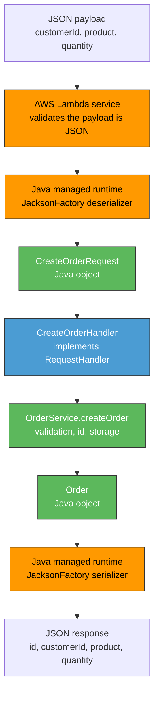

# Order Management API Serverless Workshop (AWS Lambda + API Gateway)
## Mariana Malagón Tochoy

This repository contains the progressive implementation of a small **Order Management REST API**
built with Java 17, deployed with AWS Lambda and exposed through Amazon API Gateway.

## Workshop progress

| # | Point | Workshop section | Status |
|---|---|---|---|
| 1 | API design and contract | 4 | Done |
| 2 | Plain Java implementation | 5 | Done |
| 3 | Local JUnit tests, mvn test/package, Checkpoint 1 | 6 | Done |
| 4 | Deploy a Java function to Lambda, JSON mapping investigation, Checkpoint 2 | 7 | Done |
| 5 | Design the HTTP interface with API Gateway (GET /orders/{id}) | 8 | Pending |
| 6 | API Gateway mapping templates (non proxy), query params, POST, HTTP semantics, Checkpoint 3 | 9, 10 | Pending |
| 7 | Lambda proxy integration investigation, save example event | 11 | Pending |
| 8 | HTTP adapter, implement responses with proxy integration | 12, 13 | Pending |
| 9 | Compare the two architectures | 14 | Pending |
| 10 | AI assisted development reflection and criticism of agent decisions | 15, 16 | Pending |
| 11 | Final challenge: DELETE /orders/{id} (prediction then implementation) | 17 | Pending |
| 12 | Final API review and architecture diagram | 18, 19 | Pending |
| 13 | Deliverables and demonstration video | 20, 21 | Pending |

## 1. API Design

### 1.1 Resources

The API exposes a single resource: **Order**.

- `/orders`: the collection of orders.
- `/orders/{id}`: a single order, identified by its id.

An order has the shape:

```json
{
  "id": "ORD-001",
  "customerId": "CUST-42",
  "product": "MacBook Air",
  "quantity": 1
}
```

### 1.2 Endpoints

| Operation | Method | URL | Path params | Query params | Request body | Success response | Success status | Error status |
|---|---|---|---|---|---|---|---|---|
| Create an order | POST | `/orders` | N/A | N/A | `{ "customerId", "product", "quantity" }` | Created order (with generated `id`) | `201 Created` | `400 Bad Request`, `500 Internal Server Error` |
| Retrieve an order | GET | `/orders/{id}` | `id` | N/A | N/A | The order | `200 OK` | `404 Not Found`, `500 Internal Server Error` |
| Find orders by customer | GET | `/orders` | N/A | `customerId` | N/A | List of orders (possibly empty) | `200 OK` | `400 Bad Request` (missing/invalid `customerId`), `500 Internal Server Error` |
| Delete an order | DELETE | `/orders/{id}` | `id` | N/A | N/A | N/A | `204 No Content` | `404 Not Found`, `500 Internal Server Error` |

### 1.3 Error format

All error responses share a consistent JSON shape:

```json
{
  "error": "ORDER_NOT_FOUND",
  "message": "Order ORD-999 does not exist"
}
```

`error` is a stable, machine-readable code; `message` is a human-readable explanation.

### 1.4 Design questions

**What are the resources in your API?**
Just one business resource: the `Order`. It is exposed as a collection (`/orders`) and as an
individual item (`/orders/{id}`). `customerId` is not modeled as its own resource, it is used
only as a filter over the orders collection.

**Why did you choose `/orders/{id}` to retrieve a particular order?**
`{id}` identifies one specific, addressable resource inside the `/orders` collection, which is
the standard REST convention for "get one item from a collection". It keeps the URL hierarchical
and predictable, and it reuses the same path shape for GET, and later DELETE, on that resource.

**Why is `customerId` represented as a query parameter in the search operation?**
`customerId` is a *filter* applied to the orders collection, not an identifier of a single
resource, the result is a list, not one order. Query parameters are the REST convention for
filtering/searching a collection, and this approach also leaves room to add more filters later
(e.g. `?customerId=...&product=...`) without changing the URL structure.

**What should `POST /orders` return when an order is successfully created?**
`201 Created`, with the full representation of the created order (including the generated `id`)
in the response body. A `Location` header pointing to `/orders/{id}` is appropriate, since a new
resource was created at that URL.

**What should the API return when an order does not exist?**
`404 Not Found`, with a JSON error body using the error format above, e.g.
`{"error": "ORDER_NOT_FOUND", "message": "Order ORD-999 does not exist"}`.

**What information should an error response contain?**
A stable error code (`error`) that client code can branch on, and a human-readable `message` for
logs/debugging. Both fields are always present; no stack traces or internal details are exposed.

## 2. Plain Java Implementation

The application logic is implemented as an ordinary Java 17 Maven project. At this stage it has
**no knowledge of HTTP, API Gateway, Lambda or Spring**: the only dependency in `pom.xml` is JUnit,
and it is `test` scoped.

### 2.1 Project structure

```
TDSE_Serverless_RestAPI_AWSLambda/
├── pom.xml
├── README.md
└── src/
    ├── main/java/com/escuelaing/orders/
    │   ├── model/
    │   │   ├── Order.java                     immutable order
    │   │   └── CreateOrderRequest.java        input of the create operation
    │   ├── exception/
    │   │   ├── OrderException.java            base error, carries a stable error code
    │   │   ├── OrderNotFoundException.java    ORDER_NOT_FOUND
    │   │   └── InvalidOrderException.java     INVALID_ORDER
    │   ├── repository/
    │   │   ├── OrderRepository.java           storage port
    │   │   └── InMemoryOrderRepository.java   orders held in process memory
    │   └── service/
    │       ├── OrderIdGenerator.java          source of ids
    │       ├── SequentialOrderIdGenerator.java  ORD-001, ORD-002, ...
    │       └── OrderService.java              application logic
    └── test/java/com/escuelaing/orders/
```

### 2.2 Operations

`OrderService` offers exactly the three operations of the initial contract, in terms of Java
objects and exceptions:

| Operation | Signature | Failure |
|---|---|---|
| Create | `Order createOrder(CreateOrderRequest request)` | `InvalidOrderException` |
| Retrieve | `Order getOrder(String id)` | `InvalidOrderException`, `OrderNotFoundException` |
| Search by customer | `List<Order> getOrdersByCustomer(String customerId)` | `InvalidOrderException` |

`DELETE /orders/{id}` is part of the published contract but is intentionally **not** implemented
yet: section 17 of the workshop asks for a written prediction before the change is made.

Searching a customer with no orders returns an **empty list, not an error**: the `/orders`
collection exists, it simply has no match. Only a missing `customerId` is an error.

### 2.3 Design decisions and why

**`OrderRepository` as an interface, with an in-memory implementation.**
The service depends on a storage port, not on a `Map`. The business logic therefore never changes
if the orders later move to DynamoDB, and every test can start from a clean repository.
`InMemoryOrderRepository` uses a `ConcurrentHashMap` because one Lambda container can serve
requests on several threads, and it offers a `withSampleData()` factory so that a cold Lambda can
already answer a `GET` before any `POST` reaches that same execution environment.

**Id generation behind an `OrderIdGenerator` interface.**
`createOrder` assigns the id, never the client. Keeping the generator injectable makes the service
deterministic under test: a test injects a generator returning a known id and asserts the exact
value. The default `SequentialOrderIdGenerator` keeps an `AtomicInteger` in process memory, so on
Lambda the counter restarts on every cold start and is not shared between execution environments.
That is acceptable for the workshop and is exactly the kind of state that would move to the
database in a real system.

**`Order` immutable, `CreateOrderRequest` a mutable JavaBean.**
`Order` is only ever produced by the application and serialized to a response, so it exposes
getters only. `CreateOrderRequest` is only ever consumed, and it is deliberately a JavaBean with a
public no-argument constructor and setters, because the AWS Lambda Java runtime deserializes the
incoming JSON into a POJO with Jackson and needs those members. Java 17 `record` types would read
better here, and this is a conscious concession to the runtime rather than an oversight; it is
revisited in the analysis of section 16.

**Validation lives in the service.**
Rules such as "quantity must be greater than zero" are business rules, so they belong to the
application and run no matter who calls it. The exceptions carry a stable error code
(`ORDER_NOT_FOUND`, `INVALID_ORDER`) which is the same code the API contract publishes in the
`error` field. The application states **what** went wrong; translating that into `400` or `404` is
the responsibility of whoever exposes it over HTTP, not of the application.

### 2.4 Build

```bash
mvn compile
```

The project targets `release 17`, so the generated bytecode is Java 17 (class file major version
61) and runs on the Lambda `java17` runtime even though it was built with a newer JDK.

## 3. Local Tests and Checkpoint 1

### 3.1 Test suite

35 JUnit 5 tests, all green, none of which touches AWS, the network or a server:

| Test class | Tests | Covers |
|---|---|---|
| `OrderServiceTest` | 26 | creation of a valid order, retrieval of an existing order, behavior when an order does not exist, search by customer, invalid input |
| `InMemoryOrderRepositoryTest` | 6 | save and find by id, unknown id, overwrite, filter by customer, ordering, sample data |
| `SequentialOrderIdGeneratorTest` | 3 | id format, starting value, growth past three digits |

The cases required by the workshop, and where they live:

| Required case | Test |
|---|---|
| Creation of a valid order | `createsAValidOrderAndAssignsTheId`, `storesTheCreatedOrderSoItCanBeRetrieved` |
| Retrieval of an existing order | `retrievesAnExistingOrder` |
| Order does not exist | `failsWithOrderNotFoundWhenTheOrderDoesNotExist` |
| Search orders by customer | `findsTheOrdersOfACustomerSortedById`, `returnsAnEmptyListWhenTheCustomerHasNoOrders` |
| Invalid input | `rejectsInvalidInput` (8 parameterized cases), `rejectsAMissingRequestBody`, `rejectsABlankOrderId`, `rejectsABlankCustomerId` |

Two tests exist specifically to pin down design decisions rather than behavior:
`ignoresAnyIdTheClientMightTryToChoose` injects `() -> "ORD-999"` as the id generator, which only
works because `OrderIdGenerator` is a one-method interface, and
`doesNotStoreAnythingWhenTheInputIsInvalid` checks that a rejected request leaves no trace in the
repository.

### 3.2 Running it

```bash
mvn test
mvn package
```

```
Tests run: 35, Failures: 0, Errors: 0, Skipped: 0
BUILD SUCCESS
Building jar: target/orders-api-1.0-SNAPSHOT.jar
```

### 3.3 Checkpoint 1

**Can the application functionality be tested without AWS?**
Yes, and it is. The 35 tests run with `mvn test` on a laptop with no AWS credentials, no network
access and no emulator. This is possible because `OrderService` receives its collaborators through
the constructor (`OrderRepository`, `OrderIdGenerator`) and communicates in Java objects and
exceptions, so a test can build it with a clean in-memory repository and a deterministic id
generator. The tests run in roughly 0.25 s, which is the real benefit: the feedback loop does not
involve a deployment.

**Does your application require a web server?**
No. There is no servlet, no embedded Tomcat, no port, no listening socket. `OrderService` is
invoked as a plain Java method call. Later on, AWS Lambda plays the role that a web server would
play in a traditional deployment, and the application does not need to know.

**Does it require Spring Boot?**
No. There is no framework, no dependency injection container and no annotations. Wiring is done by
hand in a constructor, which is enough for three collaborators and keeps the cold start of the
Lambda small, since there is no classpath scanning or context to build at startup.

**What does the generated JAR contain?**
`target/orders-api-1.0-SNAPSHOT.jar`, 12 KB, containing:

- the 10 compiled `.class` files of `com.escuelaing.orders` (model, exception, repository, service);
- `META-INF/MANIFEST.MF`;
- `META-INF/maven/com.escuelaing/orders-api/pom.xml` and `pom.properties`, Maven's own metadata.

It contains **no dependencies**: JUnit is `test` scoped, so it is not packaged, and the test
classes are not included either. It is also **not yet deployable to Lambda**: there is no handler
class and no `aws-lambda-java-core` on the classpath. Section 7 adds both, and with them the need
for a fat JAR, since Lambda does not resolve Maven dependencies at runtime.

**Which parts of your application currently know about HTTP?**
None. Searching the source tree for HTTP concepts returns nothing: no status codes, no headers, no
request or response types, no URLs. HTTP exists only in two places outside the code, the API
contract in section 1 of this README and the eventual API Gateway configuration.

The closest thing to a leak is the error code carried by `OrderException`
(`ORDER_NOT_FOUND`, `INVALID_ORDER`), and it is deliberately **not** HTTP: it names the business
failure, not a status. The mapping `ORDER_NOT_FOUND -> 404` and `INVALID_ORDER -> 400` is written
in exactly one place, the adapter of section 12. A second mild leak is `CreateOrderRequest` being a
JavaBean to suit the Lambda JSON deserializer, which is infrastructure influencing the shape of a
model class, though not its behavior.

## 4. Deploying a Java Function to AWS Lambda

One operation, "create an order", is deployed as a Lambda function. The application was **not**
redesigned for it: `OrderService` and the model classes are untouched, and all that was added is a
handler class.

### 4.1 The handler

```java
public class CreateOrderHandler implements RequestHandler<CreateOrderRequest, Order> {

    private static final OrderService SERVICE = OrderService.withDefaults();

    @Override
    public Order handleRequest(CreateOrderRequest request, Context context) {
        return SERVICE.createOrder(request);
    }
}
```

Three decisions are visible in those few lines:

- The handler **delegates and nothing else**. It does not validate, does not build ids and does not
  catch exceptions, because none of that is infrastructure work.
- The service is a `static` field, so it is built once per execution environment and survives warm
  invocations instead of being rebuilt on every request. Section 4.6 shows this experimentally.
- The signature carries the mapping contract: by declaring `RequestHandler<CreateOrderRequest,
  Order>`, the handler tells the runtime which type to deserialize the payload into.

`CreateOrderHandlerTest` exercises it as a plain object, passing `null` as the `Context` because
the handler never uses it. Nothing about this class requires a running Lambda to be tested.

### 4.2 Packaging

`aws-lambda-java-core` was added to `pom.xml`, together with `maven-shade-plugin`, because **Lambda
does not resolve Maven dependencies at runtime**: the deployment package must already contain them.
`mvn package` now produces two JARs, and the difference is worth noting:

| File | Size | Contents |
|---|---|---|
| `original-orders-api-1.0-SNAPSHOT.jar` | 13 KB | only the project classes, the plain JAR of section 3 |
| `orders-api-1.0-SNAPSHOT.jar` | 24 KB | the project classes plus `com.amazonaws.services.lambda.runtime`, this is the one that gets uploaded |

The managed Java runtime already provides the JSON serializer, so no Jackson dependency is declared
and the package stays small, which keeps cold starts short.

### 4.3 Deployment

```bash
mvn package

aws lambda create-function \
  --function-name orders-create-order \
  --runtime java17 \
  --role arn:aws:iam::<ACCOUNT_ID>:role/LabRole \
  --handler com.escuelaing.orders.lambda.CreateOrderHandler::handleRequest \
  --zip-file fileb://target/orders-api-1.0-SNAPSHOT.jar \
  --memory-size 512 \
  --timeout 15
```

To publish a change afterwards:

```bash
mvn package
aws lambda update-function-code --function-name orders-create-order \
  --zip-file fileb://target/orders-api-1.0-SNAPSHOT.jar
```

The `--handler` value is the one piece of wiring that connects AWS to the code: it names the class
and the method that the runtime must call, in the form `package.Class::method`.

### 4.4 Invocations

Nine invocations were run against the deployed function. The payload files are in
[`docs/lambda-invocations/`](docs/lambda-invocations/) and the full inputs and outputs are recorded
in [`docs/lambda-invocations/RESULTS.md`](docs/lambda-invocations/RESULTS.md).

| # | Input | Result | What it demonstrates |
|---|---|---|---|
| 1 | valid order | `{"id":"ORD-100",...}` | JSON binds to the POJO, the returned object becomes JSON |
| 2 | different values | `{"id":"ORD-101",...}` | the same, with other data |
| 3 | extra fields `discount`, `notes` | success, extras dropped | unknown properties do not fail |
| 4 | `CustomerId` instead of `customerId` | `InvalidOrderException` | property names are case sensitive |
| 5 | `"quantity":"3"` as a string | `"quantity":3` | scalar types are coerced |
| 6 | `quantity` absent | `InvalidOrderException` | missing fields arrive as `null` |
| 7 | `"quantity":0` | `FunctionError: Unhandled` | an unhandled exception is not a `400` |
| 8 | JSON with unquoted keys | `InvalidRequestContentException` | the Invoke API validates the payload first |
| 9 | forced cold start | counter back to `ORD-100` | in-memory state is ephemeral |

### 4.5 Investigation: how the runtime converts JSON into Java objects

**The mechanism.** The Java managed runtime ships with a serializer,
`aws-lambda-java-serialization`, which is built on Jackson. When the function is loaded, the
runtime reads the generic type arguments of the implemented `RequestHandler<I, O>` interface
through reflection to discover that the input type is `CreateOrderRequest`. On every invocation it
deserializes the payload bytes into an instance of that type, calls `handleRequest`, and serializes
the returned `Order` back into the response bytes. This is why the code never mentions Jackson,
strings or streams: the conversion happens entirely outside the function, in the runtime.

**Why the model classes are shaped the way they are.** The runtime does not use a default Jackson
`ObjectMapper`. Reading `JacksonFactory` in the
[`aws-lambda-java-libs`](https://github.com/aws/aws-lambda-java-libs) source shows it is configured
with, among others:

| Setting | Value | Consequence for this project |
|---|---|---|
| `AUTO_DETECT_CREATORS` | disabled | objects are built with the no-argument constructor and then populated, so a `record` cannot be used as an input type without a custom serializer |
| `AUTO_DETECT_SETTERS`, `AUTO_DETECT_FIELDS` | enabled | `CreateOrderRequest` binds through its setters |
| `USE_STD_BEAN_NAMING` | enabled | `getCustomerId()` produces the key `customerId` |
| `FAIL_ON_UNKNOWN_PROPERTIES` | disabled | extra JSON fields are ignored instead of failing |
| `ACCEPT_CASE_INSENSITIVE_PROPERTIES` | disabled | `CustomerId` does not bind to `customerId` |
| `FAIL_ON_NULL_FOR_PRIMITIVES` | disabled | a missing `int` would arrive as `0`, so optional numbers are declared as `Integer` |
| `setSerializationInclusion(NON_NULL)` | n/a | `null` fields are omitted from the response JSON |

This is the real reason `CreateOrderRequest` is a JavaBean with a public no-argument constructor
rather than a Java 17 `record`: with `AUTO_DETECT_CREATORS` disabled, the runtime has no way to
call the canonical constructor of a record.

**Verification against the deployed function.** Each claim above was turned into an invocation and
checked, which is how experiments 3 to 6 came about. They all behaved as the configuration
predicted. Experiment 8 did **not**: the `JsonFactory` of the runtime allows unquoted field names,
yet sending such a payload failed with `InvalidRequestContentException` without the function ever
running. The conclusion is that there are two parsers in the path, the Lambda service validating
the request body of the Invoke API, and the runtime serializer inside the execution environment.
Only the second one is lenient, and the first one never lets a malformed payload reach it.

**Escape hatches.** When this default mapping does not fit, there are two documented ways out:
implement `RequestStreamHandler` and read the raw `InputStream`, or register a `CustomPojoSerializer`
through `META-INF/services`. Neither is needed here, and that is the point: the model was designed
so that the default mapping is enough.

### 4.6 Evidence that in-memory state is ephemeral

Successive invocations returned `ORD-100`, `ORD-101`, `ORD-102`, `ORD-103`, `ORD-104`, which proves
the static `OrderService` is reused by a warm execution environment. Changing the function
configuration forces AWS to start a new environment, and the next invocation returned `ORD-100`
again, with the previously created orders gone.

Two consequences for this API, both of them accepted for the workshop and documented rather than
hidden: ids are unique only within one execution environment, and an order created by one request
can be invisible to the next if it is served by a different container. The fix is not a code
change, it is a real store such as DynamoDB behind the existing `OrderRepository` interface, which
is exactly why that interface exists.

### 4.7 Checkpoint 2: the actual solution



Orange is AWS managed infrastructure, blue is the only class that knows AWS exists, and green is
ordinary Java that would run unchanged outside AWS. All the JSON handling lives in the orange
boxes, which is why the green ones never mention it.

Note what is still missing at this point: there is no URL, no HTTP method and no status code. The
function is invoked directly by its name through the AWS API, not by a client over HTTP. Adding
that is the work of sections 8 to 10.
