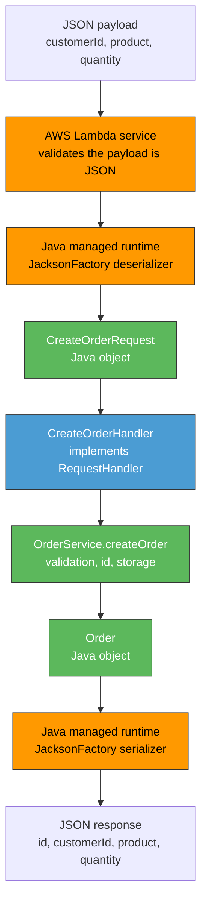
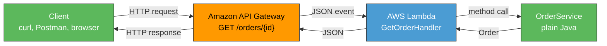
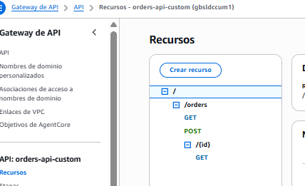
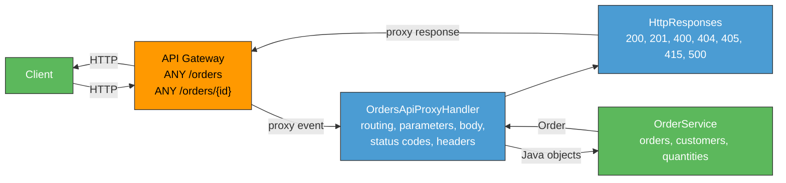
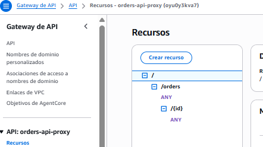
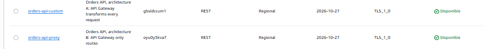

# Order Management API Serverless Workshop (AWS Lambda + API Gateway)
## Mariana Malagón Tochoy

This repository contains the progressive implementation of a small **Order Management REST API**
built with Java 17, deployed with AWS Lambda and exposed through Amazon API Gateway.

## Workshop progress

| # | Point | Workshop section | Status |
|---|---|---|---|
| 1 | API design and contract | 4 | Done |
| 2 | Plain Java implementation | 5 | Done |
| 3 | Local JUnit tests, mvn test/package, Checkpoint 1 | 6 | Done |
| 4 | Deploy a Java function to Lambda, JSON mapping investigation, Checkpoint 2 | 7 | Done |
| 5 | Design the HTTP interface with API Gateway (GET /orders/{id}) | 8 | Done |
| 6 | API Gateway mapping templates (non proxy), query params, POST, HTTP semantics, Checkpoint 3 | 9, 10 | Done |
| 7 | Lambda proxy integration investigation, save example event | 11 | Done |
| 8 | HTTP adapter, implement responses with proxy integration | 12, 13 | Done |
| 9 | Compare the two architectures | 14 | Done |
| 10 | AI assisted development reflection and criticism of agent decisions | 15, 16 | Done |
| 11 | Final challenge: DELETE /orders/{id} (prediction then implementation) | 17 | Done |
| 12 | Final API review and architecture diagram | 18, 19 | Pending |
| 13 | Deliverables and demonstration video | 20, 21 | Pending |

## 1. API Design

### 1.1 Resources

The API exposes a single resource: **Order**.

- `/orders`: the collection of orders.
- `/orders/{id}`: a single order, identified by its id.

An order has the shape:

```json
{
  "id": "ORD-001",
  "customerId": "CUST-42",
  "product": "MacBook Air",
  "quantity": 1
}
```

### 1.2 Endpoints

| Operation | Method | URL | Path params | Query params | Request body | Success response | Success status | Error status |
|---|---|---|---|---|---|---|---|---|
| Create an order | POST | `/orders` | N/A | N/A | `{ "customerId", "product", "quantity" }` | Created order (with generated `id`) | `201 Created` | `400 Bad Request`, `500 Internal Server Error` |
| Retrieve an order | GET | `/orders/{id}` | `id` | N/A | N/A | The order | `200 OK` | `404 Not Found`, `500 Internal Server Error` |
| Find orders by customer | GET | `/orders` | N/A | `customerId` | N/A | List of orders (possibly empty) | `200 OK` | `400 Bad Request` (missing/invalid `customerId`), `500 Internal Server Error` |
| Delete an order | DELETE | `/orders/{id}` | `id` | N/A | N/A | N/A | `204 No Content` | `404 Not Found`, `500 Internal Server Error` |

### 1.3 Error format

All error responses share a consistent JSON shape:

```json
{
  "error": "ORDER_NOT_FOUND",
  "message": "Order ORD-999 does not exist"
}
```

`error` is a stable, machine-readable code; `message` is a human-readable explanation.

### 1.4 Design questions

**What are the resources in your API?**
Just one business resource: the `Order`. It is exposed as a collection (`/orders`) and as an
individual item (`/orders/{id}`). `customerId` is not modeled as its own resource, it is used
only as a filter over the orders collection.

**Why did you choose `/orders/{id}` to retrieve a particular order?**
`{id}` identifies one specific, addressable resource inside the `/orders` collection, which is
the standard REST convention for "get one item from a collection". It keeps the URL hierarchical
and predictable, and it reuses the same path shape for GET, and later DELETE, on that resource.

**Why is `customerId` represented as a query parameter in the search operation?**
`customerId` is a *filter* applied to the orders collection, not an identifier of a single
resource, the result is a list, not one order. Query parameters are the REST convention for
filtering/searching a collection, and this approach also leaves room to add more filters later
(e.g. `?customerId=...&product=...`) without changing the URL structure.

**What should `POST /orders` return when an order is successfully created?**
`201 Created`, with the full representation of the created order (including the generated `id`)
in the response body. A `Location` header pointing to `/orders/{id}` is appropriate, since a new
resource was created at that URL.

**What should the API return when an order does not exist?**
`404 Not Found`, with a JSON error body using the error format above, e.g.
`{"error": "ORDER_NOT_FOUND", "message": "Order ORD-999 does not exist"}`.

**What information should an error response contain?**
A stable error code (`error`) that client code can branch on, and a human-readable `message` for
logs/debugging. Both fields are always present; no stack traces or internal details are exposed.

## 2. Plain Java Implementation

The application logic is implemented as an ordinary Java 17 Maven project. At this stage it has
**no knowledge of HTTP, API Gateway, Lambda or Spring**: the only dependency in `pom.xml` is JUnit,
and it is `test` scoped.

### 2.1 Project structure

```
TDSE_Serverless_RestAPI_AWSLambda/
├── pom.xml
├── README.md
└── src/
    ├── main/java/com/escuelaing/orders/
    │   ├── model/
    │   │   ├── Order.java                     immutable order
    │   │   └── CreateOrderRequest.java        input of the create operation
    │   ├── exception/
    │   │   ├── OrderException.java            base error, carries a stable error code
    │   │   ├── OrderNotFoundException.java    ORDER_NOT_FOUND
    │   │   └── InvalidOrderException.java     INVALID_ORDER
    │   ├── repository/
    │   │   ├── OrderRepository.java           storage port
    │   │   └── InMemoryOrderRepository.java   orders held in process memory
    │   └── service/
    │       ├── OrderIdGenerator.java          source of ids
    │       ├── SequentialOrderIdGenerator.java  ORD-001, ORD-002, ...
    │       └── OrderService.java              application logic
    └── test/java/com/escuelaing/orders/
```

### 2.2 Operations

`OrderService` offers exactly the three operations of the initial contract, in terms of Java
objects and exceptions:

| Operation | Signature | Failure |
|---|---|---|
| Create | `Order createOrder(CreateOrderRequest request)` | `InvalidOrderException` |
| Retrieve | `Order getOrder(String id)` | `InvalidOrderException`, `OrderNotFoundException` |
| Search by customer | `List<Order> getOrdersByCustomer(String customerId)` | `InvalidOrderException` |

`DELETE /orders/{id}` is part of the published contract but is intentionally **not** implemented
yet: section 17 of the workshop asks for a written prediction before the change is made.

Searching a customer with no orders returns an **empty list, not an error**: the `/orders`
collection exists, it simply has no match. Only a missing `customerId` is an error.

### 2.3 Design decisions and why

**`OrderRepository` as an interface, with an in-memory implementation.**
The service depends on a storage port, not on a `Map`. The business logic therefore never changes
if the orders later move to DynamoDB, and every test can start from a clean repository.
`InMemoryOrderRepository` uses a `ConcurrentHashMap` because one Lambda container can serve
requests on several threads, and it offers a `withSampleData()` factory so that a cold Lambda can
already answer a `GET` before any `POST` reaches that same execution environment.

**Id generation behind an `OrderIdGenerator` interface.**
`createOrder` assigns the id, never the client. Keeping the generator injectable makes the service
deterministic under test: a test injects a generator returning a known id and asserts the exact
value. The default `SequentialOrderIdGenerator` keeps an `AtomicInteger` in process memory, so on
Lambda the counter restarts on every cold start and is not shared between execution environments.
That is acceptable for the workshop and is exactly the kind of state that would move to the
database in a real system.

**`Order` immutable, `CreateOrderRequest` a mutable JavaBean.**
`Order` is only ever produced by the application and serialized to a response, so it exposes
getters only. `CreateOrderRequest` is only ever consumed, and it is deliberately a JavaBean with a
public no-argument constructor and setters, because the AWS Lambda Java runtime deserializes the
incoming JSON into a POJO with Jackson and needs those members. Java 17 `record` types would read
better here, and this is a conscious concession to the runtime rather than an oversight; it is
revisited in the analysis of section 16.

**Validation lives in the service.**
Rules such as "quantity must be greater than zero" are business rules, so they belong to the
application and run no matter who calls it. The exceptions carry a stable error code
(`ORDER_NOT_FOUND`, `INVALID_ORDER`) which is the same code the API contract publishes in the
`error` field. The application states **what** went wrong; translating that into `400` or `404` is
the responsibility of whoever exposes it over HTTP, not of the application.

### 2.4 Build

```bash
mvn compile
```

The project targets `release 17`, so the generated bytecode is Java 17 (class file major version
61) and runs on the Lambda `java17` runtime even though it was built with a newer JDK.

## 3. Local Tests and Checkpoint 1

### 3.1 Test suite

35 JUnit 5 tests, all green, none of which touches AWS, the network or a server:

| Test class | Tests | Covers |
|---|---|---|
| `OrderServiceTest` | 26 | creation of a valid order, retrieval of an existing order, behavior when an order does not exist, search by customer, invalid input |
| `InMemoryOrderRepositoryTest` | 6 | save and find by id, unknown id, overwrite, filter by customer, ordering, sample data |
| `SequentialOrderIdGeneratorTest` | 3 | id format, starting value, growth past three digits |

The cases required by the workshop, and where they live:

| Required case | Test |
|---|---|
| Creation of a valid order | `createsAValidOrderAndAssignsTheId`, `storesTheCreatedOrderSoItCanBeRetrieved` |
| Retrieval of an existing order | `retrievesAnExistingOrder` |
| Order does not exist | `failsWithOrderNotFoundWhenTheOrderDoesNotExist` |
| Search orders by customer | `findsTheOrdersOfACustomerSortedById`, `returnsAnEmptyListWhenTheCustomerHasNoOrders` |
| Invalid input | `rejectsInvalidInput` (8 parameterized cases), `rejectsAMissingRequestBody`, `rejectsABlankOrderId`, `rejectsABlankCustomerId` |

Two tests exist specifically to pin down design decisions rather than behavior:
`ignoresAnyIdTheClientMightTryToChoose` injects `() -> "ORD-999"` as the id generator, which only
works because `OrderIdGenerator` is a one-method interface, and
`doesNotStoreAnythingWhenTheInputIsInvalid` checks that a rejected request leaves no trace in the
repository.

### 3.2 Running it

```bash
mvn test
mvn package
```

```
Tests run: 35, Failures: 0, Errors: 0, Skipped: 0
BUILD SUCCESS
Building jar: target/orders-api-1.0-SNAPSHOT.jar
```

### 3.3 Checkpoint 1

**Can the application functionality be tested without AWS?**
Yes, and it is. The 35 tests run with `mvn test` on a laptop with no AWS credentials, no network
access and no emulator. This is possible because `OrderService` receives its collaborators through
the constructor (`OrderRepository`, `OrderIdGenerator`) and communicates in Java objects and
exceptions, so a test can build it with a clean in-memory repository and a deterministic id
generator. The tests run in roughly 0.25 s, which is the real benefit: the feedback loop does not
involve a deployment.

**Does your application require a web server?**
No. There is no servlet, no embedded Tomcat, no port, no listening socket. `OrderService` is
invoked as a plain Java method call. Later on, AWS Lambda plays the role that a web server would
play in a traditional deployment, and the application does not need to know.

**Does it require Spring Boot?**
No. There is no framework, no dependency injection container and no annotations. Wiring is done by
hand in a constructor, which is enough for three collaborators and keeps the cold start of the
Lambda small, since there is no classpath scanning or context to build at startup.

**What does the generated JAR contain?**
`target/orders-api-1.0-SNAPSHOT.jar`, 12 KB, containing:

- the 10 compiled `.class` files of `com.escuelaing.orders` (model, exception, repository, service);
- `META-INF/MANIFEST.MF`;
- `META-INF/maven/com.escuelaing/orders-api/pom.xml` and `pom.properties`, Maven's own metadata.

It contains **no dependencies**: JUnit is `test` scoped, so it is not packaged, and the test
classes are not included either. It is also **not yet deployable to Lambda**: there is no handler
class and no `aws-lambda-java-core` on the classpath. Section 7 adds both, and with them the need
for a fat JAR, since Lambda does not resolve Maven dependencies at runtime.

**Which parts of your application currently know about HTTP?**
None. Searching the source tree for HTTP concepts returns nothing: no status codes, no headers, no
request or response types, no URLs. HTTP exists only in two places outside the code, the API
contract in section 1 of this README and the eventual API Gateway configuration.

The closest thing to a leak is the error code carried by `OrderException`
(`ORDER_NOT_FOUND`, `INVALID_ORDER`), and it is deliberately **not** HTTP: it names the business
failure, not a status. The mapping `ORDER_NOT_FOUND -> 404` and `INVALID_ORDER -> 400` is written
in exactly one place, the adapter of section 12. A second mild leak is `CreateOrderRequest` being a
JavaBean to suit the Lambda JSON deserializer, which is infrastructure influencing the shape of a
model class, though not its behavior.

## 4. Deploying a Java Function to AWS Lambda

One operation, "create an order", is deployed as a Lambda function. The application was **not**
redesigned for it: `OrderService` and the model classes are untouched, and all that was added is a
handler class.

### 4.1 The handler

```java
public class CreateOrderHandler implements RequestHandler<CreateOrderRequest, Order> {

    private static final OrderService SERVICE = OrderService.withDefaults();

    @Override
    public Order handleRequest(CreateOrderRequest request, Context context) {
        return SERVICE.createOrder(request);
    }
}
```

Three decisions are visible in those few lines:

- The handler **delegates and nothing else**. It does not validate, does not build ids and does not
  catch exceptions, because none of that is infrastructure work.
- The service is a `static` field, so it is built once per execution environment and survives warm
  invocations instead of being rebuilt on every request. Section 4.6 shows this experimentally.
- The signature carries the mapping contract: by declaring `RequestHandler<CreateOrderRequest,
  Order>`, the handler tells the runtime which type to deserialize the payload into.

`CreateOrderHandlerTest` exercises it as a plain object, passing `null` as the `Context` because
the handler never uses it. Nothing about this class requires a running Lambda to be tested.

### 4.2 Packaging

`aws-lambda-java-core` was added to `pom.xml`, together with `maven-shade-plugin`, because **Lambda
does not resolve Maven dependencies at runtime**: the deployment package must already contain them.
`mvn package` now produces two JARs, and the difference is worth noting:

| File | Size | Contents |
|---|---|---|
| `original-orders-api-1.0-SNAPSHOT.jar` | 13 KB | only the project classes, the plain JAR of section 3 |
| `orders-api-1.0-SNAPSHOT.jar` | 24 KB | the project classes plus `com.amazonaws.services.lambda.runtime`, this is the one that gets uploaded |

The managed Java runtime already provides the JSON serializer, so no Jackson dependency is declared
and the package stays small, which keeps cold starts short.

### 4.3 Deployment

```bash
mvn package

aws lambda create-function \
  --function-name orders-create-order \
  --runtime java17 \
  --role arn:aws:iam::<ACCOUNT_ID>:role/LabRole \
  --handler com.escuelaing.orders.lambda.CreateOrderHandler::handleRequest \
  --zip-file fileb://target/orders-api-1.0-SNAPSHOT.jar \
  --memory-size 512 \
  --timeout 15
```

To publish a change afterwards:

```bash
mvn package
aws lambda update-function-code --function-name orders-create-order \
  --zip-file fileb://target/orders-api-1.0-SNAPSHOT.jar
```

The `--handler` value is the one piece of wiring that connects AWS to the code: it names the class
and the method that the runtime must call, in the form `package.Class::method`.

### 4.4 Invocations

Nine invocations were run against the deployed function. The payload files are in
[`docs/lambda-invocations/`](docs/lambda-invocations/) and the full inputs and outputs are recorded
in [`docs/lambda-invocations/RESULTS.md`](docs/lambda-invocations/RESULTS.md).

| # | Input | Result | What it demonstrates |
|---|---|---|---|
| 1 | valid order | `{"id":"ORD-100",...}` | JSON binds to the POJO, the returned object becomes JSON |
| 2 | different values | `{"id":"ORD-101",...}` | the same, with other data |
| 3 | extra fields `discount`, `notes` | success, extras dropped | unknown properties do not fail |
| 4 | `CustomerId` instead of `customerId` | `InvalidOrderException` | property names are case sensitive |
| 5 | `"quantity":"3"` as a string | `"quantity":3` | scalar types are coerced |
| 6 | `quantity` absent | `InvalidOrderException` | missing fields arrive as `null` |
| 7 | `"quantity":0` | `FunctionError: Unhandled` | an unhandled exception is not a `400` |
| 8 | JSON with unquoted keys | `InvalidRequestContentException` | the Invoke API validates the payload first |
| 9 | forced cold start | counter back to `ORD-100` | in-memory state is ephemeral |

### 4.5 Investigation: how the runtime converts JSON into Java objects

**The mechanism.** The Java managed runtime ships with a serializer,
`aws-lambda-java-serialization`, which is built on Jackson. When the function is loaded, the
runtime reads the generic type arguments of the implemented `RequestHandler<I, O>` interface
through reflection to discover that the input type is `CreateOrderRequest`. On every invocation it
deserializes the payload bytes into an instance of that type, calls `handleRequest`, and serializes
the returned `Order` back into the response bytes. This is why the code never mentions Jackson,
strings or streams: the conversion happens entirely outside the function, in the runtime.

**Why the model classes are shaped the way they are.** The runtime does not use a default Jackson
`ObjectMapper`. Reading `JacksonFactory` in the
[`aws-lambda-java-libs`](https://github.com/aws/aws-lambda-java-libs) source shows it is configured
with, among others:

| Setting | Value | Consequence for this project |
|---|---|---|
| `AUTO_DETECT_CREATORS` | disabled | objects are built with the no-argument constructor and then populated, so a `record` cannot be used as an input type without a custom serializer |
| `AUTO_DETECT_SETTERS`, `AUTO_DETECT_FIELDS` | enabled | `CreateOrderRequest` binds through its setters |
| `USE_STD_BEAN_NAMING` | enabled | `getCustomerId()` produces the key `customerId` |
| `FAIL_ON_UNKNOWN_PROPERTIES` | disabled | extra JSON fields are ignored instead of failing |
| `ACCEPT_CASE_INSENSITIVE_PROPERTIES` | disabled | `CustomerId` does not bind to `customerId` |
| `FAIL_ON_NULL_FOR_PRIMITIVES` | disabled | a missing `int` would arrive as `0`, so optional numbers are declared as `Integer` |
| `setSerializationInclusion(NON_NULL)` | n/a | `null` fields are omitted from the response JSON |

This is the real reason `CreateOrderRequest` is a JavaBean with a public no-argument constructor
rather than a Java 17 `record`: with `AUTO_DETECT_CREATORS` disabled, the runtime has no way to
call the canonical constructor of a record.

**Verification against the deployed function.** Each claim above was turned into an invocation and
checked, which is how experiments 3 to 6 came about. They all behaved as the configuration
predicted. Experiment 8 did **not**: the `JsonFactory` of the runtime allows unquoted field names,
yet sending such a payload failed with `InvalidRequestContentException` without the function ever
running. The conclusion is that there are two parsers in the path, the Lambda service validating
the request body of the Invoke API, and the runtime serializer inside the execution environment.
Only the second one is lenient, and the first one never lets a malformed payload reach it.

**Escape hatches.** When this default mapping does not fit, there are two documented ways out:
implement `RequestStreamHandler` and read the raw `InputStream`, or register a `CustomPojoSerializer`
through `META-INF/services`. Neither is needed here, and that is the point: the model was designed
so that the default mapping is enough.

### 4.6 Evidence that in-memory state is ephemeral

Successive invocations returned `ORD-100`, `ORD-101`, `ORD-102`, `ORD-103`, `ORD-104`, which proves
the static `OrderService` is reused by a warm execution environment. Changing the function
configuration forces AWS to start a new environment, and the next invocation returned `ORD-100`
again, with the previously created orders gone.

Two consequences for this API, both of them accepted for the workshop and documented rather than
hidden: ids are unique only within one execution environment, and an order created by one request
can be invisible to the next if it is served by a different container. The fix is not a code
change, it is a real store such as DynamoDB behind the existing `OrderRepository` interface, which
is exactly why that interface exists.

### 4.7 Checkpoint 2: the actual solution



Orange is AWS managed infrastructure, blue is the only class that knows AWS exists, and green is
ordinary Java that would run unchanged outside AWS. All the JSON handling lives in the orange
boxes, which is why the green ones never mention it.

Note what is still missing at this point: there is no URL, no HTTP method and no status code. The
function is invoked directly by its name through the AWS API, not by a client over HTTP. Adding
that is the work of sections 8 to 10.

## 5. Designing the HTTP Interface

The function of section 4 runs in AWS, but it is not a REST API: it has no URL, no method and no
status code, and it can only be invoked through the AWS API by its name. Amazon API Gateway is what
turns it into an endpoint.



### 5.1 The question to answer first

A client calls:

```
GET /orders/ORD-42
```

but the application only needs one string, `ORD-42`. The design question is therefore not "how do
I parse an HTTP request in Java", it is **who extracts that value**. Two answers are possible, and
the workshop asks for both, one in sections 9 and 10 and the other in sections 11 to 13.

| | Architecture A, custom integration | Architecture B, proxy integration |
|---|---|---|
| Who reads the path | API Gateway | the Lambda handler |
| What Lambda receives | a small document designed by me | the full API Gateway event |
| Integration type | `AWS` | `AWS_PROXY` |
| Java code that knows HTTP | none | one adapter class |

Section 5 designs A, which is the one where the application stays furthest away from HTTP.

### 5.2 How API Gateway extracts the path parameter

In a custom (non-proxy) integration, API Gateway builds the Lambda event with a **mapping template**
written in Velocity Template Language (VTL). The template runs on the integration request, for a
given `Content-Type`, and whatever it prints becomes the invocation payload.

The variables available inside a template are:

| Expression | Returns |
|---|---|
| `$input.params('id')` | one parameter by name, searching path, then query string, then headers |
| `$input.params().path.id` | the same value, naming the source explicitly |
| `$input.params().querystring.customerId` | a query string parameter |
| `$input.json('$')` | the whole request body as JSON |
| `$input.path('$.field')` | one field of the body |
| `$input.body` | the raw body as a string |
| `$context.requestId`, `$context.httpMethod` | data about the request itself |
| `$util.escapeJavaScript(...)` | escaping, which AWS recommends around body values because unescaped characters make API Gateway answer `400` |

So the answer to "how does API Gateway extract `{id}`" is: the resource is declared as
`/orders/{id}`, which makes `id` a path parameter, and the template reads it with
`$input.params('id')`.

### 5.3 The integration contract

This is the document each function will receive, and it is a design decision, not something AWS
imposes:

| Operation | Mapping template | Lambda receives | Java input type |
|---|---|---|---|
| `GET /orders/{id}` | `{"id": "$input.params('id')"}` | `{"id":"ORD-42"}` | `GetOrderRequest` |
| `GET /orders?customerId=X` | `{"customerId": "$input.params('customerId')"}` | `{"customerId":"CUST-42"}` | a request type of its own |
| `POST /orders` | `$input.json('$')` | the body unchanged | `CreateOrderRequest` |

Two things are deliberate here.

**The input is a named object, not a bare string.** `GET /orders/{id}` could have been given the
template `"$input.params('id')"`, producing the JSON string `"ORD-42"` and a handler declared as
`RequestHandler<String, Order>`. An object was chosen instead because it can grow: adding a filter
or a second parameter later becomes one more field, while a bare string would force a breaking
change on both sides.

**The POST template passes the body through untouched.** The client already sends exactly the JSON
that `CreateOrderRequest` expects, so transforming it would only add a place for the two shapes to
drift apart.

### 5.4 What the Java side looks like

```java
public class GetOrderHandler implements RequestHandler<GetOrderRequest, Order> {

    private static final OrderService SERVICE = OrderService.withDefaults();

    @Override
    public Order handleRequest(GetOrderRequest request, Context context) {
        return SERVICE.getOrder(request == null ? null : request.getId());
    }
}
```

The application is untouched again: `OrderService.getOrder(String)` was already written in section
2 and still receives a plain `String`. The new code is one handler and one request class, and
neither mentions URLs, methods or headers.

`GetOrderHandlerTest` covers the happy path, the missing order, and the case where a misconfigured
mapping template sends `{"id": ""}` or nothing at all, which is the realistic failure mode of this
architecture: a template bug arrives at the application as an empty field.

### 5.5 What is still missing, and why it is not trivial

Returning the right **status codes** is the part that section 10 has to solve, and the research for
it produced two findings that shape the implementation:

1. **In a custom integration, a Lambda error is returned to the client as `200 OK` by default.**
   An exception does not become an error response by itself. Each status code has to be declared on
   the method response and then mapped on the integration response.
2. **The mapping is driven by a regex, `selectionPattern`, matched against `errorMessage` only.**
   Not against `errorType`, and not against any structured field. Since the application reports
   failures as `OrderNotFoundException` and `InvalidOrderException`, whose distinguishing data is
   the error **code**, that code has to travel inside the message text for API Gateway to be able
   to tell a `404` from a `400`.

That second point is the first real tension of this architecture: a decision about API Gateway
configuration reaches back into what a Java exception message must contain. Section 6 resolves it
by putting that formatting in the handler layer, so the application keeps reporting plain business
messages, and section 14 revisits it when comparing the two architectures.

A third consequence is already visible in the design: architecture A uses **one Lambda function per
operation**, each with its own execution environment and therefore its own in-memory data. An order
created through `POST /orders` is stored in the container of `orders-create-order` and is invisible
to `orders-get-order`. The preloaded sample orders (`ORD-001`, `ORD-002`, `ORD-003`) exist exactly
so the `GET` endpoints have something to return, and this limitation is a property of the
in-memory repository, not of the HTTP design.

## 6. Architecture A: API Gateway Mapping and HTTP Semantics

The three operations are now reachable over HTTP, with API Gateway transforming every request
before the Lambda sees it. The complete configuration is the script
[`infrastructure/architecture-a/create-api.sh`](infrastructure/architecture-a/create-api.sh),
which can recreate the API from zero, and every request and response observed is recorded in
[`docs/architecture-a-http-tests.md`](docs/architecture-a-http-tests.md).

### 6.1 What was built

| Method | Resource | Lambda | Request template |
|---|---|---|---|
| `GET` | `/orders/{id}` | `orders-get-order` | `{"id": "$input.params('id')"}` |
| `GET` | `/orders` | `orders-find-orders-by-customer` | `{"customerId": "$input.params('customerId')"}` |
| `POST` | `/orders` | `orders-create-order` | `$input.json('$')` |

Three functions, one per operation, all built from the same JAR and differing only in the handler
class configured in AWS.



Each method is declared explicitly, and each one carries its own template and its own responses.

### 6.2 Results

| Case | Status | Body |
|---|---|---|
| `GET /orders/ORD-001` | `200` | the order |
| `GET /orders/ORD-999` | `404` | `{"error":"ORDER_NOT_FOUND","message":"Order ORD-999 does not exist"}` |
| `GET /orders?customerId=CUST-42` | `200` | two orders |
| `GET /orders?customerId=CUST-100` | `200` | `[]` |
| `GET /orders` | `400` | `{"error":"INVALID_ORDER","message":"Query parameter 'customerId' is required"}` |
| `POST /orders` valid | `201` | the created order |
| `POST /orders` `quantity: 0` | `400` | `{"error":"INVALID_ORDER","message":"Field 'quantity' must be greater than zero"}` |
| `POST /orders` without JSON content type | `415` | generated by API Gateway |
| `DELETE /orders/ORD-001` | `403` | generated by API Gateway, the method does not exist yet |

### 6.3 How the status codes are produced

This was the hard part, and it works differently from what one would expect.

**A Lambda error is not an HTTP error.** In a custom integration, an exception thrown by the
function arrives at the client as `200 OK` unless it is mapped. Every status code has to be
declared twice: once on the **method response**, which is the contract the API publishes, and once
on the **integration response**, which decides when it applies. Forgetting the method response
produces a runtime configuration error rather than a sensible answer.

**The mapping is a regular expression over the error message, and over nothing else.** API Gateway
matches `selectionPattern` against the `errorMessage` field of the Lambda error. It cannot see the
exception type, and it cannot see any structured field. The configuration is therefore:

| Pattern | Status |
|---|---|
| none, the default response | `200`, or `201` on `POST` |
| `.*ORDER_NOT_FOUND.*` | `404` |
| `.*INVALID_ORDER.*` | `400` |
| `.*INTERNAL_ERROR.*` | `500` |

**Which forced a design decision in Java.** For those patterns to work, the error code has to be
inside the message text. Rather than contaminating `OrderService` with it, a single class in the
AWS layer does the translation:

```java
public class FunctionErrorException extends RuntimeException {

    public static FunctionErrorException from(OrderException cause) {
        return new FunctionErrorException(toJson(cause.getErrorCode(), cause.getMessage()), cause);
    }

    public static FunctionErrorException internal(Throwable cause) {
        return new FunctionErrorException(
                toJson(INTERNAL_ERROR, "The request could not be processed"), cause);
    }
}
```

The message it builds is exactly the error document of the contract, so the integration response
only has to hand it over unchanged with `$input.path('$.errorMessage')`. Without that template the
client would receive `errorType` and the full `stackTrace`, which is what the raw invocations of
section 4 returned.

Each handler therefore ends with the same three lines:

```java
try {
    return SERVICE.getOrder(request == null ? null : request.getId());
} catch (OrderException failure) {
    throw FunctionErrorException.from(failure);
} catch (RuntimeException unexpected) {
    throw FunctionErrorException.internal(unexpected);
}
```

The second `catch` answers the question the workshop asks in section 18: an unexpected internal
error becomes `500` with the contracted error body and a generic message, while the real cause
stays attached to the exception and is written to CloudWatch. Internal details are not part of the
API.

**A rejected alternative.** Pulling those three lines into an abstract `OrderFunction<I, O>` base
class, which was the obvious way to remove the duplication, would break the deployment. The Lambda
runtime discovers the input type by reflecting on the type arguments of `RequestHandler`, and a
subclass that declares no `handleRequest` of its own leaves only the erased
`handleRequest(Object, Context)` signature visible, so the payload would arrive as a `Map` instead
of a `CreateOrderRequest`. The duplication was kept on purpose, and it is one of the costs that
section 14 counts.

### 6.4 What could not be done

**The `Location` header.** `201 Created` should point to the new resource with
`Location: /orders/ORD-100`. API Gateway can map a response header from a field of the integration
response body, but it cannot concatenate a fixed prefix with that value, so the header could only
carry `ORD-100`. The options are to return the full path from the Lambda, which means teaching the
application about URLs, or to leave the header out. It was left out here and is implemented
properly in architecture B, where the adapter builds the response and can simply write it.

**A consistent error format for errors that never reach Lambda.** The `415` and the `403` above are
produced by API Gateway itself and do not follow the contract. Making them consistent requires
configuring gateway responses, which is more API Gateway configuration for something the
application already knows how to express.

### 6.5 Checkpoint 3: who is responsible for what

| Responsibility | Where it lives in architecture A |
|---|---|
| Routing a URL to code | API Gateway, one resource and method per operation |
| Extracting `{id}` from the path | API Gateway, `$input.params('id')` in a VTL template |
| Extracting `?customerId=` | API Gateway, the same mechanism |
| Transforming the request | API Gateway, one mapping template per method |
| Choosing the success status code | API Gateway, the default integration response |
| Choosing the error status code | API Gateway, `selectionPattern` over the error message |
| Shaping the error body | split: Java builds the document, API Gateway selects and forwards it |
| Content type negotiation | API Gateway, `passthrough-behavior` |
| Business validation | the Java application |
| Knowing that HTTP exists | nobody in the application, one class in the AWS layer |

**Advantages of this distribution.**

The application stays genuinely free of HTTP. `OrderService` and the model classes contain no
status code, no header and no URL, and the 50 unit tests run without any notion of a request. The
HTTP contract is declarative and inspectable: anyone can read the status codes of the API from the
API Gateway configuration without opening the Java code, and changing `201` to `200` is a
configuration change with no redeployment of code. Each function is small and independent, which
means separate permissions, separate memory sizing and separate scaling per operation. API Gateway
also absorbs work the application never has to implement, such as rejecting an unsupported media
type.

**Disadvantages.**

The behavior of the API is spread across two places that no single tool shows together. Answering
"what happens when the order does not exist" requires reading a Java class, then a selection
pattern, then a response template. None of this can be tested locally: the templates are VTL
strings inside a CLI call, and the only way to know whether `$input.params('id')` was spelled
correctly is to deploy and send a request. The error mapping is string matching, so renaming an
error code in Java silently breaks a status code with no compiler, no test and no warning.

The configuration also grows faster than the API does. Three operations already needed 3 resources
or methods, 3 request templates, 10 method responses, 10 integration responses and 3 Lambda
permissions. Each new operation adds the same handful of calls, and each new error code adds one
pattern per method that can produce it.

Finally, the split is not as clean as it looks. The error code had to be pushed into the exception
message to suit a regular expression, the `Location` header could not be expressed at all, and
`415` and `403` escape the error format of the contract. The HTTP layer did not disappear, it moved
into configuration, where it is less visible and harder to verify.

## 7. The Lambda Proxy Integration Event

Architecture B removes the mapping templates: API Gateway stops transforming anything and hands the
function a single document describing the whole HTTP request. Before writing an adapter for that
document, it is worth knowing exactly what it contains.

The events in [`docs/proxy-events/`](docs/proxy-events/) are **real**, not copied from the
documentation. They were captured by deploying a diagnostic function,
[`EventEchoHandler`](src/main/java/com/escuelaing/orders/lambda/EventEchoHandler.java), behind a
proxy integration and asking it to answer with the event it received. The whole capture is
reproducible with
[`infrastructure/capture-proxy-event.sh`](infrastructure/capture-proxy-event.sh), which creates the
throwaway API, sends the requests, saves the output and deletes everything again.

The echo function implements `RequestStreamHandler` rather than `RequestHandler` on purpose: that
interface receives the raw bytes and bypasses the automatic JSON mapping, so nothing is lost to a
POJO that happens not to declare a field.

### 7.1 Where each piece of the request appears

Captured from `GET /orders/ORD-42`, `GET /orders?customerId=CUST-42&limit=10` and a `POST /orders`:

| Information | Field in the event | Observed value |
|---|---|---|
| HTTP method | `httpMethod` | `"GET"`, `"POST"`, `"DELETE"` |
| Path requested | `path` | `"/orders/ORD-42"` |
| Route that matched | `resource` | `"/orders/{id}"` |
| Path parameters | `pathParameters` | `{"id": "ORD-42"}` |
| Query parameters | `queryStringParameters` | `{"customerId": "CUST-42", "limit": "10"}` |
| Repeated query parameters | `multiValueQueryStringParameters` | `{"customerId": ["CUST-42"], "limit": ["10"]}` |
| Headers | `headers` | `Content-Type`, `Host`, `User-Agent`, `X-Forwarded-For`, and any custom header such as `X-Workshop` |
| Repeated headers | `multiValueHeaders` | the same, as lists |
| Request body | `body` | `"{\"customerId\":\"CUST-42\",...}"`, **a string, not an object** |
| Binary body flag | `isBase64Encoded` | `false` |
| Stage, request id, caller ip, timestamps | `requestContext` | `stage`, `requestId`, `requestTime`, `identity.sourceIp`, `apiId`, `accountId`, and more |

The `sourceIp` and `X-Forwarded-For` values in the saved files were replaced with the documentation
address `203.0.113.10`, since the originals were a real home IP address.

### 7.2 Four details that matter when writing the adapter

**The body is a string, not a parsed object.** API Gateway does not look inside it. The adapter is
the one that has to parse it, and it has to be ready for a body that is not valid JSON at all.

**Absent collections arrive as `null`, not as empty maps.** `GET /orders` with no query string has
`"queryStringParameters": null`, and `/orders` as a resource without path parameters has
`"pathParameters": null`. Reading them without a null check is the most likely bug in an adapter,
and the captured events are the proof that it has to be handled.

**`resource` and `path` are different things.** `resource` is the route that matched,
`/orders/{id}`, which is what routing should be based on. `path` is the concrete URL,
`/orders/ORD-42`. Using `path` to decide which operation to run means re-parsing a string that API
Gateway already parsed.

**The shape of `pathParameters` depends on how the resource is declared.** The same request,
`GET /orders/ORD-42`, produces:

| Declared resource | `resource` | `pathParameters` |
|---|---|---|
| `/orders/{id}` | `/orders/{id}` | `{"id": "ORD-42"}` |
| `/{proxy+}` | `/{proxy+}` | `{"proxy": "orders/ORD-42"}` |

Both are saved, in `get-order-by-id.json` and `greedy-route-same-request.json`. With a greedy route
the adapter would have to split `"orders/ORD-42"` by hand, which is routing work that API Gateway
already knows how to do. Architecture B therefore declares the real resources, `/orders` and
`/orders/{id}`, and keeps API Gateway responsible for routing and for parameter extraction, while
the adapter becomes responsible for everything else.

A practical note from building the capture: when a single API declared both `/orders/{id}` and a
root level `/{proxy+}`, every request was dispatched to the greedy route. The two examples were
captured from separate APIs for that reason.

### 7.3 What this costs and what it buys

The event is large, around 1.5 KB of JSON for a request with no body, and most of it is of no
interest to the application. In exchange, **every HTTP concern is now expressible in Java**: the
method, the matched route, the parameters, the headers and the body all arrive as data in a single
object, so routing, validation, status codes and the response body can be decided in code that
compiles and that can be tested on a laptop.

That is the trade the next section implements.

## 8. Architecture B: the HTTP Adapter

The same API, implemented a second time. API Gateway no longer transforms anything: it routes and
forwards, and a single Lambda function answers every request.



The blue layer is new. The green layer is the same code as section 2, unmodified:
`OrderService`, `Order`, `CreateOrderRequest`, `OrderRepository`. It was not touched to make this
work, which is the result the workshop asks for.

### 8.1 The pieces

| Class | Responsibility |
|---|---|
| [`OrdersApiProxyHandler`](src/main/java/com/escuelaing/orders/lambda/proxy/OrdersApiProxyHandler.java) | routing, parameter extraction, body parsing, mapping exceptions to status codes |
| [`HttpResponses`](src/main/java/com/escuelaing/orders/lambda/proxy/HttpResponses.java) | building the responses: status code, `Content-Type`, `Location`, JSON body |



The same two resources as architecture A, but a single `ANY` method on each: API Gateway is no
longer told which methods exist, so answering `DELETE` with a correct `405` is the job of the
adapter.

**Routing is done on `resource`, not on `path`.** `resource` is the route API Gateway already
matched, `/orders/{id}`, while `path` is the concrete URL. Using `path` would mean parsing a string
that has already been parsed. A test pins this down by setting `path` to nonsense and checking the
request is still routed correctly.

**Error mapping lives in one `try/catch`:**

```java
try {
    return route(request);
} catch (OrderNotFoundException notFound) {
    return HttpResponses.error(404, notFound.getErrorCode(), notFound.getMessage());
} catch (InvalidOrderException invalid) {
    return HttpResponses.error(400, invalid.getErrorCode(), invalid.getMessage());
} catch (MalformedBodyException malformed) {
    return HttpResponses.error(400, "MALFORMED_JSON", malformed.getMessage());
} catch (RuntimeException unexpected) {
    return HttpResponses.error(500, "INTERNAL_ERROR", "The request could not be processed");
}
```

Eleven lines replace the selection patterns, the method responses and the response templates of
architecture A, for all three operations at once. The last `catch` is the answer to section 18:
an unexpected failure is `500` with the contracted body, logged to CloudWatch and never shown to
the client.

**Null safety is a requirement, not a precaution.** The captured events of section 7 show that
`pathParameters` and `queryStringParameters` arrive as `null` when the route has none, so the
adapter reads them through helpers that check. There is a test for each case.

### 8.2 What the adapter gained that architecture A could not express

| | Architecture A | Architecture B |
|---|---|---|
| `Location` on `201` | not expressible, parameter mappings cannot concatenate | `Location: /dev/orders/ORD-100`, built from the request path |
| Body that is not JSON | never reaches the function | `400 MALFORMED_JSON` in the contract format |
| Wrong media type | `415`, with a body invented by API Gateway | `415` in the contract format |
| `DELETE` with no operation | `403 Missing Authentication Token` | `405 METHOD_NOT_ALLOWED`, explained |

### 8.3 Tested on a laptop, against real AWS events

This is the practical difference. The 15 tests of
[`OrdersApiProxyHandlerTest`](src/test/java/com/escuelaing/orders/lambda/proxy/OrdersApiProxyHandlerTest.java)
cover routing, every status code, the `Location` header, the error format and the null cases, and
they run in half a second with `mvn test`.

They are not fed hand written events. They **deserialize the real events captured in section 7**
from `docs/proxy-events/`:

```java
private static APIGatewayProxyRequestEvent capturedEvent(String name) throws IOException {
    return JSON.readValue(Path.of("docs", "proxy-events", name).toFile(),
            APIGatewayProxyRequestEvent.class);
}
```

So a test that says `GET /orders/ORD-999` answers `404` is asserting against the document AWS
actually sends. In architecture A the equivalent guarantee did not exist: a VTL template cannot be
compiled or unit tested, and the only way to check it is to deploy.

**A bug this caught, and what it says about the design.** The first version of the handler kept the
`OrderService` in a `static` field, which is what Lambda wants so that a warm execution environment
reuses it. The suite then started failing: an order created by one test was still there in the
next one. The fix was to inject the service through a constructor and keep the static instance as
the default the runtime uses:

```java
private static final OrderService SHARED_SERVICE = OrderService.withDefaults();

public OrdersApiProxyHandler() {          // the constructor the runtime calls
    this(SHARED_SERVICE);
}

OrdersApiProxyHandler(OrderService service) {   // the one the tests call
    this.service = service;
}
```

The same tension exists in the three functions of architecture A, where it stays invisible simply
because those handlers are never exercised deeply enough to notice.

### 8.4 What it cost

**The deployment package went from 24 KB to 3.3 MB**, from 10 classes to 1626. The adapter needs
`aws-lambda-java-events` for the typed event and `jackson-databind` to parse a body that arrives as
a string, neither of which architecture A required, since the runtime did all the JSON work and
API Gateway did the extraction. A bigger package means a slower cold start.

**The HTTP contract is no longer declarative.** In architecture A the status codes could be read
from the API Gateway configuration without opening any Java. Here they are only visible by reading
the handler.

**One function means one blast radius.** A bug in routing affects every operation, and all
operations share the same memory, timeout and permissions, instead of being sized per operation.

### 8.5 Deployment

```bash
mvn package
bash infrastructure/architecture-b/create-api.sh
```

The script is 67 lines against 165 for architecture A, and most of the difference is exactly the
configuration that moved into Java: no mapping template, no method response, no integration
response, no selection pattern. Two resources, one `ANY` method each, one integration, one
permission, one deployment.

Every request and response observed against the deployed API is recorded in
[`docs/architecture-b-http-tests.md`](docs/architecture-b-http-tests.md).

## 9. Comparing the Two Architectures

Both architectures are deployed and answer the same contract, so the comparison is made against
two working systems rather than against expectations.



| | A, custom integration | B, proxy integration |
|---|---|---|
| Lambda functions | 3, one per operation | 1 |
| API Gateway resources | 2 | 2 |
| Methods | 3, one per operation | 2, `ANY` |
| Mapping templates | 3 request, 1 response reused 8 times | 0 |
| Method responses | 10 | 0 |
| Integration responses | 10 | 0 |
| Selection patterns | 8 | 0 |
| Deployment script | 165 lines | 67 lines |
| Java specific to the architecture | 182 lines | 256 lines |
| Extra dependencies | none | `aws-lambda-java-events`, `jackson-databind` |
| Deployment package | 24 KB, 10 classes | 3.3 MB, 1626 classes |
| Application code | 451 lines, identical | 451 lines, identical |

### 9.1 Which approach required more API Gateway configuration?

Architecture A, and not by a small margin. Exposing three operations needed 3 request templates,
10 method responses, 10 integration responses and 8 selection patterns, none of which exists in
architecture B. The script that builds it is 165 lines against 67, and the difference is almost
entirely that configuration.

The asymmetry is structural, not accidental. In A, every status code must be declared twice, on
the method response and on the integration response, for every method that can produce it. In B,
API Gateway is told only where the function is.

### 9.2 Which approach required more Java infrastructure code?

Architecture B: 256 lines across two classes against 182 lines across five. Measured as a share of
the project it is closer than it sounds, but the real cost of B is not the lines, it is the two
dependencies they drag in and what those do to the deployment package: **24 KB and 10 classes
become 3.3 MB and 1626 classes**. A needed no JSON library because the runtime did the mapping and
API Gateway did the extraction; B has to parse a body that arrives as a string and build a response
object, and that is what `jackson-databind` is for.

Architecture A is not free of infrastructure code either. `FunctionErrorException` exists only
because `selectionPattern` matches the message of an exception, and the three handlers repeat the
same `try/catch` because the obvious refactor into a base class would break the type discovery of
the runtime. That is infrastructure code too, it is just smaller and stranger.

### 9.3 Which was easier to test locally?

Architecture B, decisively, and this is the difference that matters most in practice.

Its 15 tests cover routing, all seven status codes, the `Location` header, the error format and the
cases where API Gateway sends `null` instead of an empty map, and they run in half a second with
`mvn test`. They are fed the **real events captured from AWS** in section 7, so they assert against
the document API Gateway actually sends.

In architecture A, the Java handlers are testable, but the HTTP behavior is not. A mapping template
is a VTL string inside a CLI call: it does not compile, it has no type checking and it cannot be
unit tested. The only way to find out whether `$input.params('id')` was spelled correctly, or
whether `.*ORDER_NOT_FOUND.*` matches the message, is to deploy and send a request. Both mistakes
are silent: a wrong parameter name arrives as an empty field, and a pattern that stops matching
quietly turns a `404` into a `200`.

### 9.4 Where are the HTTP status codes defined in each approach?

| | Where |
|---|---|
| A, success | API Gateway, the integration response with no selection pattern, one per method |
| A, errors | API Gateway, one selection pattern per code per method, matched against the error message built in `FunctionErrorException` |
| B, all | `HttpResponses` and the `try/catch` of `OrdersApiProxyHandler`, in Java |

In A the codes are data in the AWS configuration and can be read without opening the source, which
is genuinely useful. In B they are code, which means they can be grepped, reviewed in a pull
request, versioned with the logic they belong to, and tested.

### 9.5 What happens if the API grows from 3 operations to 30?

**Architecture A grows linearly in configuration.** Each operation adds a method, a request
template and roughly three method responses and three integration responses, so thirty operations
mean on the order of 240 configuration objects, each created by its own CLI call and none of them
checked by a compiler. It also tends to mean more functions: with the one function per operation
model used here, thirty operations are thirty deployment packages, thirty sets of permissions and
thirty cold starts to worry about. At that scale the configuration stops being written by hand and
moves to CloudFormation, SAM, CDK or Terraform, which solves the repetition but not the fact that
the behavior still cannot be tested without deploying.

**Architecture B grows linearly in code, which is cheaper.** Each operation adds a branch and a
method in the adapter, and only a new URL shape adds API Gateway configuration. The real risk is
different: the `if` chain that routes three operations becomes unreadable at thirty, so it would
have to become a routing table keyed by method and resource, with one class per operation behind
it, and the single function becomes a single point of failure whose cold start grows with the
whole API. A reasonable compromise at that size is several proxy functions, one per resource
family, each with its own adapter.

Section 11 is a concrete measurement of this question rather than a prediction: adding `DELETE`
costs nothing in API Gateway under `ANY`, and a new method, a template and several responses under
architecture A.

### 9.6 Which approach makes the Java business logic cleaner?

**Neither. They are identical, and that is the result.** `OrderService`, `Order`,
`CreateOrderRequest`, `OrderRepository` and the exceptions are the same 451 lines in both, written
in section 2 and never modified since. Searching the application for `http`, `status`, `header` or
`servlet` returns nothing under either architecture.

That is the whole point of the workshop question. Keeping the business logic clean was not achieved
by the choice of integration, it was achieved by deciding, before any of this existed, that the
application would receive Java objects and report failures as exceptions. Both architectures then
had to adapt to it.

If anything, architecture A contaminates the application very slightly more. The error code travels
inside the exception message because a regular expression needs to find it there, which is an API
Gateway concern reaching into the shape of a message. It was confined to the AWS layer, but the
reason it exists at all comes from the infrastructure.

### 9.7 Which approach would be easier for another developer to understand?

Architecture B. To understand what `GET /orders/ORD-42` does, a developer opens one file, follows a
method call and reads a `try/catch`. They can set a breakpoint, run the tests and change something
with the compiler checking them.

To understand the same request in architecture A, they need the Java handler, the request template,
the method responses, the integration responses and the selection patterns, which live in the AWS
console or in a CLI script, and they need to know that `selectionPattern` matches `errorMessage`
with a Java regex. That last piece is not discoverable: nothing in the code says it, and the
`FunctionErrorException` class only makes sense once you know it.

The counterargument is fair and worth stating: a developer who already knows API Gateway can read
the whole HTTP contract of architecture A from the console, with no Java at all, and that is a real
advantage for someone operating the API rather than changing it.

### 9.8 Which approach would you choose for a larger system, and why?

**Architecture B**, for a system expected to grow and to be maintained by a team, for four reasons
in order of weight:

1. **The behavior is testable.** 15 tests against real AWS events, running in half a second,
   against zero possible tests for a mapping template. On a larger system this is the difference
   between refactoring confidently and not refactoring.
2. **The behavior is reviewable and versioned.** A change to a status code appears in a diff next
   to the logic that caused it. In architecture A it is a CLI call or a click in a console, and the
   repository shows nothing.
3. **Mistakes are caught by the compiler** instead of by a regular expression that silently stops
   matching.
4. **The HTTP contract can be expressed completely.** The `Location` header, the error format for
   a malformed body and a correct `405` were all expressible in B and partly or entirely out of
   reach in A.

With three conditions attached. The routing must become a table rather than an `if` chain before it
reaches ten operations. The package size must be watched, because 3.3 MB of dependencies is a cold
start cost that architecture A does not pay. And the adapter must stay an adapter: the moment
business rules start appearing in `OrdersApiProxyHandler`, the separation this workshop is about is
lost, and nothing in the proxy architecture prevents that from happening.

Architecture A remains the better answer in two specific situations: when the integration is a thin
pass through to something that is not even a Lambda, such as a DynamoDB or SQS integration with no
code at all, and when the operating team must be able to change the HTTP surface without a code
deployment. Neither applies to this API.

## 10. AI-Assisted Development, and a Critique of It

### 10.1 How the assistant was used

The workshop was built with an AI coding assistant, section by section, under three rules.

**The architecture was decided before any code was written.** Each section started with the design
question, not with a request for an implementation: what the integration contract between API
Gateway and Lambda should be, where validation belongs, what an error document contains. Code came
after that was settled.

**Claims were verified, not accepted.** This turned out to matter more than anything else. When the
assistant explained how the Lambda Java runtime converts JSON into objects, the explanation was
checked against the configuration of `JacksonFactory` in the `aws-lambda-java-libs` source and then
against the deployed function with nine invocations. One of the predictions was wrong: a payload
with unquoted field names was expected to be accepted, because the runtime parser is lenient, and
it was rejected by the Lambda service before reaching the function. That correction is in section
4.5, and it is the clearest reason not to take an explanation on trust.

**The commits were made by hand, one per section**, after reading the change. The assistant
proposed commit messages but never ran git.

What the assistant was genuinely good at: writing the boilerplate of the CLI scripts, remembering
that `pathParameters` can be `null`, and finding the exact AWS behavior when asked for a source.
What it was not good at: knowing when a pattern it proposed would collide with how the Lambda
runtime works, which is the subject of the next section.

### 10.2 Six decisions examined

#### Decision 1. One Lambda function per operation in architecture A, one for everything in B

**What it proposed.** Three functions, `orders-create-order`, `orders-get-order` and
`orders-find-orders-by-customer`, for the custom integration, and a single `orders-api-proxy` for
the proxy integration.

**Why it probably proposed it.** Each mapping template produces a different document, so a
different input type per function follows naturally, and the one function per operation shape is
the textbook presentation of a custom integration. For the proxy integration a single function is
equally conventional, since the event already carries the route.

**Do I agree?** For architecture A, yes, and it also made the comparison honest, because it is what
that style of integration naturally leads to. For a real system, no: three functions multiply
deployments, permissions and cold starts for three methods on one resource.

**Alternative.** One function for architecture A as well, with the mapping template adding a field
such as `{"operation": "getOrder", "id": "..."}`. That keeps one deployment package but moves
routing into a string invented in a VTL template, with no compiler and no test protecting it. It is
the worst of both worlds: the dispatch of architecture B without its type safety.

**What was implemented and why.** Three functions in A, one in B. The split made a limitation
visible that would otherwise have stayed hidden: an order created through `POST` is invisible to
`GET`, because each function has its own memory. That is documented with the actual responses in
`docs/architecture-a-http-tests.md`, and it is a better argument for a real database than any
explanation.

#### Decision 2. `CreateOrderRequest` as a mutable JavaBean instead of a Java 17 `record`

**What it proposed.** A class with a public no-argument constructor, getters and setters, in a
project that targets Java 17 and where a `record` would be the idiomatic choice.

**Why it probably proposed it.** Because the Lambda runtime builds the input object with the
no-argument constructor and then populates it, and a record cannot be built that way.

**Do I agree?** Yes, but only because the reason was verified instead of asserted. The claim was
checked in the `JacksonFactory` source, where `AUTO_DETECT_CREATORS` is disabled, and then on the
deployed function. Without that evidence it would have been an arbitrary restriction on the model.

**Alternative.** Keep `record` types in the application and add a separate DTO in the AWS layer, or
register a `CustomPojoSerializer` through `META-INF/services` so that records can be deserialized.
The first adds a class and a mapping per operation, the second adds a dependency and a service file
to make the language feature work.

**What was implemented and why.** JavaBeans, with the reason written in the class comment so the
next reader does not "fix" it into a record. This is the one place where infrastructure visibly
shaped a model class, and section 3 admits it rather than hiding it.

#### Decision 3. Putting the error code inside the exception message

**What it proposed.** `FunctionErrorException`, whose message is the full error document
`{"error":"ORDER_NOT_FOUND","message":"..."}`, so that an API Gateway selection pattern can match
`.*ORDER_NOT_FOUND.*` and the integration response can forward it with
`$input.path('$.errorMessage')`.

**Why it probably proposed it.** Because API Gateway matches selection patterns against
`errorMessage` and against nothing else, so there is no structured field to route on. Encoding the
document in the message is the only way to get both the status code and the error body right.

**Do I agree?** Reluctantly. It works and it is well confined, but a JSON document inside an
exception message is not something anyone would write if the infrastructure did not demand it. It
is the clearest case in the project of configuration dictating the shape of code.

**Alternative.** Let the raw Lambda error reach the client and map only the status code, which
leaks `errorType` and the full stack trace, or build the error body in VTL by taking the message
apart inside the response template, which moves string parsing into an untestable place.

**What was implemented and why.** The proposal, with one change: the translation lives in the AWS
layer only. `OrderService` keeps throwing `OrderNotFoundException` with the plain message "Order
ORD-999 does not exist", and architecture B never uses `FunctionErrorException` at all, since it
maps exceptions to status codes directly. The contamination is real but it stops at the boundary.

#### Decision 4. Hiding storage and id generation behind interfaces

**What it proposed.** `OrderRepository` with an in-memory implementation, and `OrderIdGenerator`
with a sequential implementation, for a workshop that explicitly does not require a database.

**Why it probably proposed it.** It is the standard ports and adapters answer, and it is the kind
of structure that reads as "good design" by default.

**Do I agree?** Partly, and this is the decision I pushed back on hardest. Two interfaces with one
implementation each, for an application that stores three orders in a map, is the definition of
speculative generality. The question is whether each one earns its place.

`OrderIdGenerator` does, for a concrete reason: it makes the service deterministic under test. The
tests assert `ORD-001` exactly, and `ignoresAnyIdTheClientMightTryToChoose` injects `() -> "ORD-999"`
as a one-line lambda. Without the interface those tests would have to accept any id.

`OrderRepository` is weaker. Nothing in this project has a second implementation, and the tests
could use the concrete class. What it does buy is precise: the in-memory store is the one part of
this system that is known to be wrong, section 4.6 proves it with a cold start, and the interface
is where the fix will go.

**Alternative.** A `Map` field inside `OrderService` and a `UUID` for ids. Fewer classes, and the
same behavior for everything the workshop asks for.

**What was implemented and why.** Both interfaces were kept, the id generator because it is paid
for by the tests, the repository because the limitation it abstracts is documented and measured
rather than hypothetical. If neither had been true, the `Map` would have been the better answer.

#### Decision 5. Holding the service in a `static` field, which was wrong

**What it proposed.** `private static final OrderService SERVICE = OrderService.withDefaults();` in
every handler, so the instance is created once per execution environment and reused by warm
invocations.

**Why it probably proposed it.** It is correct and standard advice for Lambda: initialization
outside the handler method runs once per container instead of once per request.

**Do I agree?** It is right about Lambda and wrong about everything else, and the tests proved it.
When the proxy adapter grew a test that creates an order, an unrelated test that counts the orders
of a customer started failing: the static service carried state from one test into the next. The
suite caught a defect that no amount of reading would have.

**Alternative.** Keep the static field and make the tests tolerant, asserting "contains ORD-001"
instead of "has exactly two orders". That hides the problem and makes the tests weaker.

**What was implemented and why.** Constructor injection with the static instance as the default:

```java
private static final OrderService SHARED_SERVICE = OrderService.withDefaults();

public OrdersApiProxyHandler() {        // the constructor the runtime calls
    this(SHARED_SERVICE);
}

OrdersApiProxyHandler(OrderService service) {   // the one the tests call
    this.service = service;
}
```

Lambda still gets its warm reuse and the tests get isolation. The three handlers of architecture A
still carry the original version, and the honest reason is that they are never exercised deeply
enough for it to hurt.

A second proposal in the same area was rejected outright: pulling the repeated `try/catch` of those
three handlers into an abstract `OrderFunction<I, O>` base class. It is the obvious way to remove
duplication and it would have broken the deployment, because the runtime discovers the input type
from the type arguments of `RequestHandler`, and a subclass that declares no `handleRequest` of its
own leaves only the erased `handleRequest(Object, Context)` visible, so payloads would arrive as a
`Map`. The duplication was kept deliberately.

#### Decision 6. Preloading sample orders

**What it proposed.** `InMemoryOrderRepository.withSampleData()`, seeding `ORD-001`, `ORD-002` and
`ORD-003` so that a freshly started function can answer a `GET` before any `POST` has happened.

**Why it probably proposed it.** Without it, every demonstration of `GET /orders/{id}` on a cold
function returns `404`, which looks like a broken API.

**Do I agree?** Yes for the workshop, with a warning attached. Seed data makes the API demonstrable,
but it also papers over exactly the limitation the workshop warns about: it makes an ephemeral,
unshared store look like it is working.

**Alternative.** No seed data, and accept that a demonstration has to `POST` before it can `GET`.
Honest, and it would still fail in architecture A, where the two operations are different
functions with separate memory.

**What was implemented and why.** The seed data was kept, and the limitation it hides is
demonstrated explicitly instead: section 4.6 forces a cold start and shows the id counter restart,
and `docs/architecture-a-http-tests.md` shows a `POST` returning `ORD-100` followed by a `GET` on
`ORD-100` answering `404`. The convenience is kept, the illusion is not.

### 10.3 What this says about using an assistant

Four of these six decisions were accepted, one was accepted with the reasoning rewritten, and one
was wrong in a way that only a test could reveal. The pattern is consistent: the proposals were
reasonable defaults, and every time one of them failed it was because it collided with something
specific about this environment, the type discovery of the Lambda runtime, the matching rules of
`selectionPattern`, the lifetime of a static field across tests.

That is the useful summary. An assistant produces competent defaults quickly, and the defaults are
correct until the environment has an opinion. The work that cannot be delegated is knowing where
those opinions are and checking.

## 11. Final Challenge: DELETE /orders/{id}

The operation to add:

| Case | Request | Response |
|---|---|---|
| The order exists | `DELETE /orders/ORD-42` | `204 No Content`, no body |
| The order does not exist | `DELETE /orders/ORD-999` | `404 Not Found`, the contracted error document |

### 11.1 Prediction, written before implementing

This section was written and committed **before** the change was made, as the workshop requires.
Section 11.3 compares it with what actually happened and does not edit it afterwards.

**Which Java classes should change?**

| Class | Change | Why |
|---|---|---|
| `OrderRepository` | add `boolean deleteById(String id)` | the port has to be able to express removal |
| `InMemoryOrderRepository` | implement it with `ordersById.remove(id) != null` | the boolean says whether anything was actually removed |
| `OrderService` | add `void deleteOrder(String id)` | a new business operation |
| `OrdersApiProxyHandler` | one more branch, `DELETE` on `/orders/{id}` | routing is the adapter's job |

And one class that should **not** need changing: `HttpResponses` already has `noContent()`, written
when the response helpers were created, so `204` is available without touching it. `Order`,
`CreateOrderRequest` and the exceptions should not change either: `OrderNotFoundException` already
exists and already carries the right error code.

Prediction in numbers: 4 files changed, no file deleted, no new class in the application.

**Do I need a new Lambda function?**

For architecture B, no. One function serves the whole API and the new route is a branch inside it.

For architecture A, yes: a fourth function, `orders-delete-order`, with its own handler class and
its own request type, because every operation there has its own function and its own input
document.

**Does the API Gateway configuration need to change?**

For architecture B, **not at all**, and this is the sharpest claim of the prediction. The resource
`/orders/{id}` is already declared with an `ANY` method, so `DELETE` already reaches the function.
It can be verified today: the current deployment answers `405 METHOD_NOT_ALLOWED` to a `DELETE`,
which means the request is arriving at the adapter and being rejected by Java, not by AWS.

For architecture A, yes, and substantially: a `DELETE` method on `/orders/{id}`, a request template,
method responses for `204`, `400`, `404` and `500`, the matching integration responses with their
selection patterns, a Lambda permission and a new deployment. Roughly a dozen CLI calls against
zero.

**Where should the deletion logic reside?**

Split in two, exactly like the other operations. Removing the entry belongs to
`InMemoryOrderRepository`, since it is the only class that knows how orders are stored. Deciding
what deletion *means*, that the id must be present and that deleting something that does not exist
is a failure, belongs to `OrderService`.

**Where should the decision to return 204 or 404 reside?**

Two different decisions that are easy to confuse.

The decision **that the order does not exist** is the application's. `OrderService.deleteOrder`
should throw `OrderNotFoundException`, the same exception `getOrder` already throws, rather than
returning a boolean for someone else to interpret. Whether an order exists is a domain question,
not an HTTP one.

The decision **that this becomes a 404, and that success becomes a 204 rather than a 200**, is the
adapter's. It goes in the `try/catch` of `OrdersApiProxyHandler`, which already maps
`OrderNotFoundException` to `404`, so that half needs no change at all. Only the success side is
new: `DELETE` answers `204` where `GET` answers `200`.

Prediction: the `catch` blocks do not change, only the routing branch.

**Which tests should be added?**

| Level | Test |
|---|---|
| `InMemoryOrderRepositoryTest` | deleting an existing order returns `true` and removes it |
| | deleting an unknown id returns `false` |
| | a deleted order disappears from `findByCustomerId` |
| `OrderServiceTest` | an existing order is deleted and can no longer be retrieved |
| | deleting an unknown order throws `OrderNotFoundException` with code `ORDER_NOT_FOUND` |
| | a blank or null id is rejected with `InvalidOrderException` |
| | deleting one order leaves the others untouched |
| `OrdersApiProxyHandlerTest` | `DELETE` on an existing order answers `204` with no body |
| | `DELETE` on a missing order answers `404` with the contracted error document |

And one existing test that must **change**: `answers405ForAMethodThatIsNotImplementedYet` feeds the
captured `delete-order.json` event and expects `405`. Once the operation exists it should expect
`404`, because that captured event asks for `ORD-42`, which is not among the preloaded orders.
That test changing is itself the proof that the saved event is real input and not decoration.

**What I expect to get wrong.**

Two risks, written down so they can be checked honestly afterwards.

First, `204 No Content` must have **no body at all**. `HttpResponses.noContent()` sets the body to
`null` and the headers to an empty map, but whether API Gateway then returns a genuinely empty
response, or the string `null`, has not been verified. This is the most likely surprise.

Second, in architecture A a handler for this operation would return `void`, so the runtime would
serialize the result as `null` and API Gateway would hand the client the literal text `null` as the
body of a `204`, unless the integration response is given an empty template. Architecture A would
need an extra piece of configuration that architecture B does not, which, if true, is one more
measurement for section 9.

### 11.2 What was implemented

`DELETE /orders/{id}` was implemented in **both** architectures, so that the claim made in section
9.5, that the operation costs nothing in B and a lot in A, could be measured instead of argued.

**The application**, shared by both:

```java
public void deleteOrder(String id) {
    if (isBlank(id)) {
        throw new InvalidOrderException("Field 'id' is required");
    }
    if (!repository.deleteById(id.trim())) {
        throw new OrderNotFoundException(id.trim());
    }
}
```

The repository answers a factual question, whether anything was removed. The service turns that
into the domain statement that deleting an absent order is a failure. Neither mentions `204` or
`404`.

**Architecture B**, one branch and one method in the adapter:

```java
if (ORDER_BY_ID.equals(resource) && "DELETE".equals(method)) {
    return deleteOrder(request);
}

private APIGatewayProxyResponseEvent deleteOrder(APIGatewayProxyRequestEvent request) {
    service.deleteOrder(pathParameter(request, "id"));
    return HttpResponses.noContent();
}
```

The `catch` blocks were not touched: `OrderNotFoundException` was already mapped to `404`.

**Architecture A**, a fourth function and seven steps of configuration, in
[`infrastructure/architecture-a/add-delete.sh`](infrastructure/architecture-a/add-delete.sh):
the function, the `DELETE` method, the integration and its request template, four method responses,
four integration responses, a Lambda permission and a new deployment.

**Observed, against the deployed APIs:**

```
architecture A                                architecture B
DELETE /orders/ORD-001   204, empty body      DELETE /orders/ORD-001   204, empty body
DELETE /orders/ORD-001   404                  GET    /orders/ORD-001   404
DELETE /orders/ORD-999   404                  GET    /orders?customerId=CUST-42   200, one order left
```

### 11.3 Prediction against reality

| Prediction | Result |
|---|---|
| 4 files change in the application and the adapter | correct: `OrderRepository`, `InMemoryOrderRepository`, `OrderService`, `OrdersApiProxyHandler` |
| `HttpResponses` does not need to change | correct, `noContent()` was already there |
| No new class in the application for architecture B | correct |
| No new Lambda for B, a fourth one for A | correct |
| **No API Gateway change at all for B** | **correct**, the deployed API answered `DELETE` with no AWS change whatsoever |
| About a dozen CLI calls for A | correct: 1 function, 1 method, 1 integration, 4 method responses, 4 integration responses, 1 permission, 1 deployment, 13 in total |
| Deletion split between repository and service | correct |
| The application decides existence, the adapter decides the status code | correct |
| The `catch` blocks do not change, only the routing branch | correct |
| 9 tests added, 1 existing test must change | partly correct, see below |
| Risk 1: the `204` might carry the text `null` | **wrong**, and interesting |
| Risk 2: architecture A would need an empty response template | **wrong**, for the same reason |

**Where the prediction was wrong, and what it taught.**

Both risks were the same mistake. The function of architecture A returns `void`, and a direct
invocation confirms the runtime answers with the four characters `null`:

```bash
aws lambda invoke --function-name orders-delete-order --payload '{"id":"ORD-001"}' out.json
# out.json contains exactly: null
```

So the premise was right. The conclusion was not: API Gateway returned **zero bytes** to the
client, both with the empty response template and after it was removed and the API redeployed. A
`204 No Content` is not allowed to carry a body, and API Gateway enforces that rather than passing
the payload through. The empty template was configuration written to solve a problem that does not
exist, and it was deleted from the script after being measured. What was not tested is whether the
same payload would be forwarded under a status code that does allow a body, so the finding is
stated narrowly: with `204`, the body is dropped.

**Two smaller inaccuracies, recorded rather than quietly fixed.**

The prediction said "no new class in the application". That was true of architecture B and false of
A, which needed `DeleteOrderRequest` as well as `DeleteOrderHandler`, because in a custom
integration every operation publishes its own input document. The prediction had been written
thinking about B.

The count was 9 tests added and 1 changed; the implementation added 15 and replaced 1. The extra
ones came from writing them: that deleting twice fails the second time, that a deleted order
disappears from the search by customer, that other orders are untouched. None of them were
foreseen, and all of them are worth having.

**One confirmation that was not in the prediction at all.** The first requests to the new `DELETE`
of architecture A answered `403 Missing Authentication Token` even though the method, the
integration, the four responses and the deployment all existed and were correct. The same request
succeeded minutes later with no change. `test-invoke-method`, which bypasses the stage, answered
`204` immediately, which is what located the problem: the deployment had not yet propagated to the
stage. It is worth recording because `403 Missing Authentication Token` is the same answer API
Gateway gives for a route that does not exist, so the obvious diagnosis is to go looking for a
configuration mistake that is not there.

### 11.4 What this measured about the two architectures

| | Architecture A | Architecture B |
|---|---|---|
| Java classes added | 2 | 0 |
| Java files changed | 3 | 4 |
| New Lambda functions | 1 | 0 |
| API Gateway objects created | 10 | 0 |
| CLI calls | 13 | 0 |
| New deployment required | yes | no |
| Could the change be tested before deploying | the handler yes, the HTTP behavior no | entirely, 3 new adapter tests |

This is the concrete version of the question "what happens when the API grows from 3 operations to
30". The fourth operation cost nothing in API Gateway under architecture B and thirteen calls under
architecture A, and that gap repeats for every operation after it.
